# OMEN: The Last Block

A small story game about a courier, a missing payment, and a network that is quietly failing.

You are **KAI**, a courier on a tiny planet. In the village of **Blockhaven**, Maya's tea stall has
a problem: a customer's payment for forty cups of festival chai has been "pending" since dawn.
Follow the receipt to Orin, the eccentric relay engineer, relight the plaza's network lantern, and
deliver his sealed findings back to Maya. Then find out who has been watching you from the lookout.

**New: scan & pay.** Walk up to Maya's chai stall, scan the UPI QR on her sign, and pay with
crypto. Test USDT settles on **Whitechain Sepolia** through OMEN's checkout contract, a 0G-powered
safety check screens the QR first, and your wallet writes the receipt to **Arkiv**. Or play with
**1,000,000 DEMO credits** and no wallet at all.

> **What's real and what isn't.** The *story's* blocks, relays and confirmations are fiction and
> labelled simulated. *Payments* are either **REAL TESTNET** (Whitechain Sepolia test USDT, which has
> no monetary value) or **DEMO** (play money in your browser). The **rupee payout to the merchant is
> always simulated**: OMEN has no licensed INR/UPI payout partner, and every screen says so.

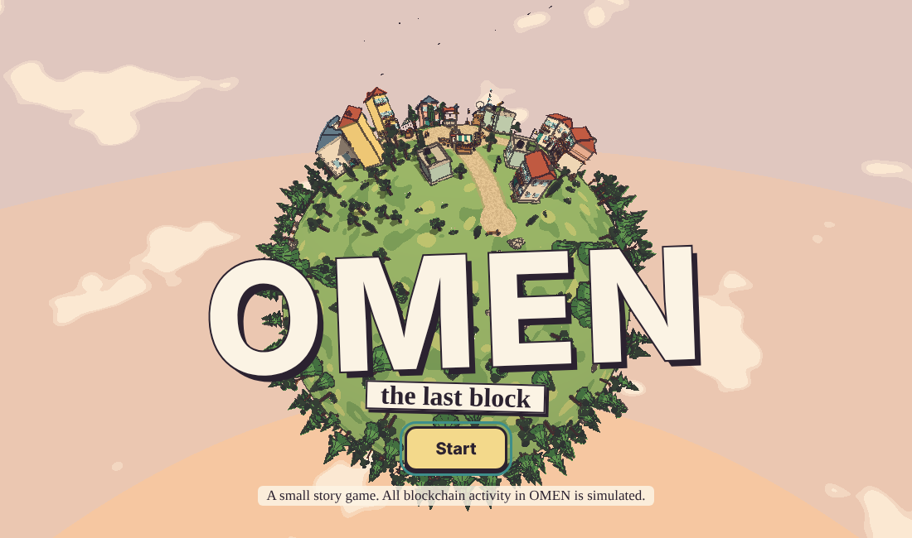

| | |
|---|---|
| 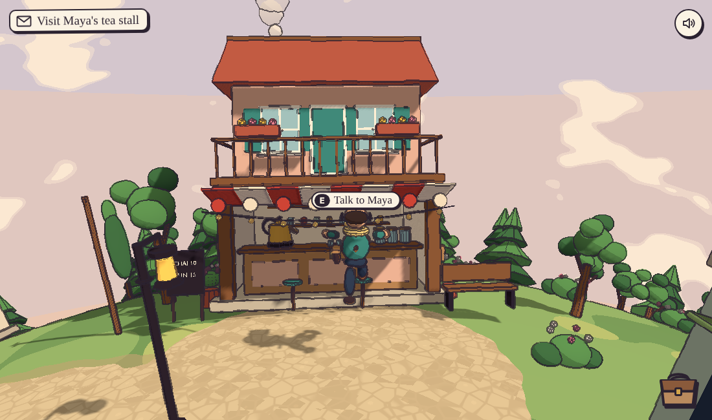 | 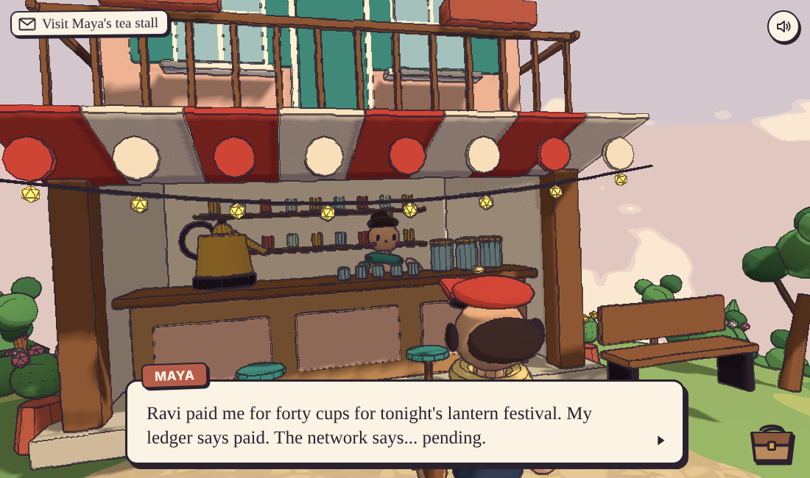 |
| 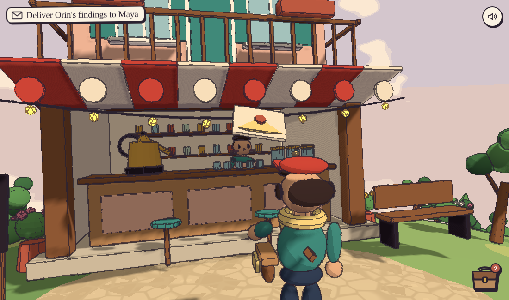 | 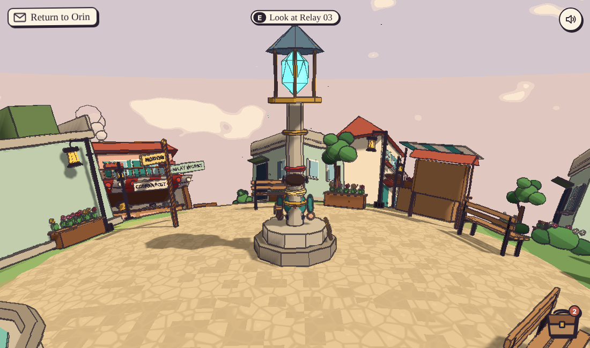 |

## Play

```bash
npm install
npm run dev                  # game + payment gateway on http://localhost:5173
npm test                     # gateway, UPI, risk and Arkiv-record tests (Node)
npm run test:contracts       # Solidity tests (Foundry)
npm run build && npm start   # production: built game + API from one Node server on :8787
```

DEMO credits work with no configuration. For USDT, Arkiv and 0G see
[Configure the sponsor integrations](#configure-the-sponsor-integrations).

**Controls:** WASD or arrow keys to walk, Shift to run, Space to jump, E or Enter to talk,
drag to look around, Tab to open the satchel, P to open the wallet. On phones: a joystick, Talk and Jump buttons, and a
swipe area to look around. Progress saves to the browser automatically.

## Scan & pay

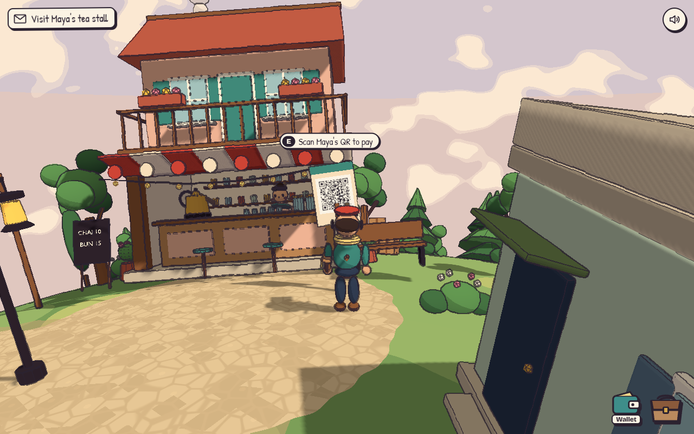

| | |
|---|---|
| 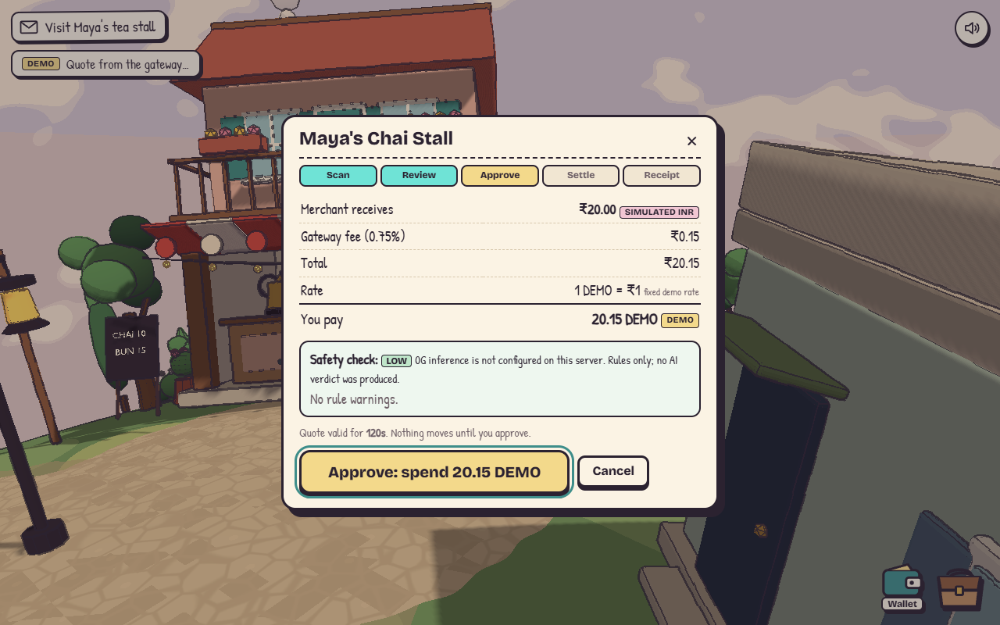 | 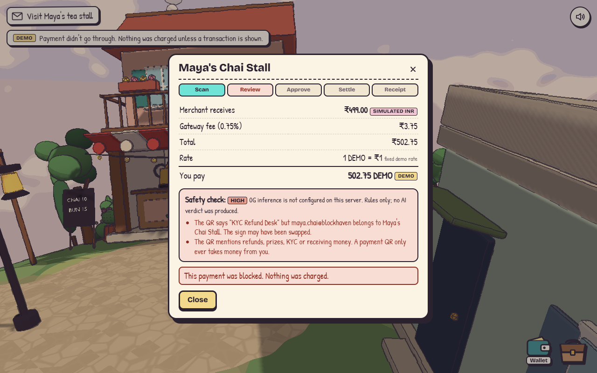 |
| 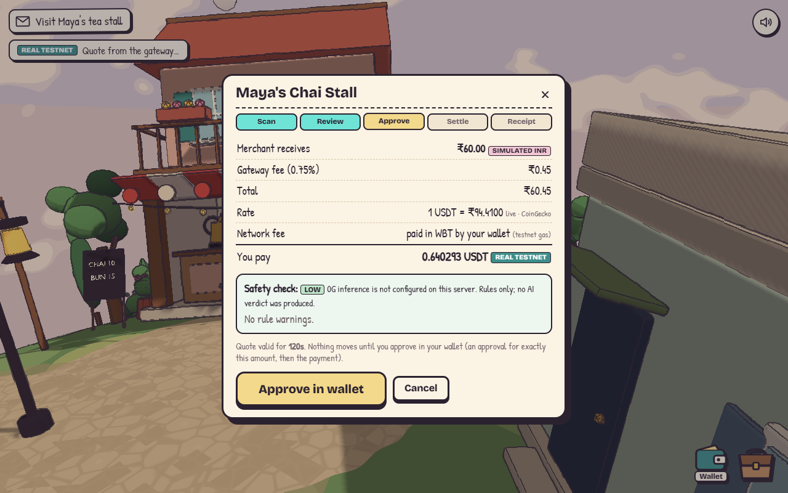 | 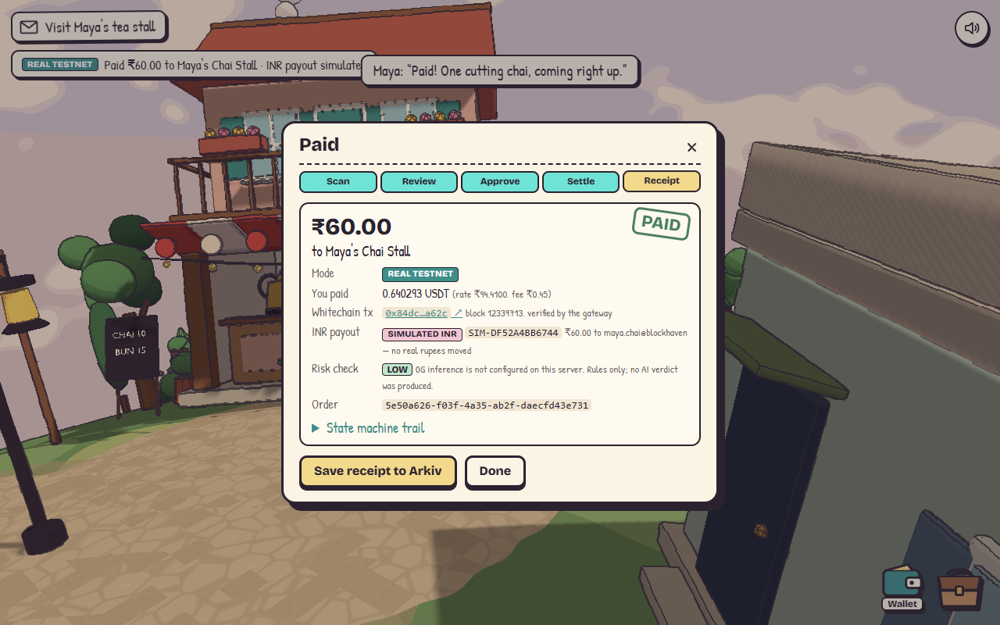 |

<sub>The two USDT screenshots were taken against a **local anvil fork** of Whitechain Sepolia (see
[Verify the USDT flow on a local fork](#verify-the-usdt-flow-on-a-local-fork)); their tx link does
not exist on the public explorer. The DEMO screenshots are from the normal dev build.</sub>

**In the village**

- **QR signs** stand by Maya's counter and outside Orin's workshop. Each is a real UPI QR texture
  (`upi://pay?pa=maya.chai@blockhaven&pn=…`); pressing **E** decodes the sign's pixels with jsQR.
  Maya and Orin also offer "Scan your QR" in conversation (outside the story's key beats).
- **Wallet** button (or **P**): connect any EVM wallet (EIP-6963 or injected), see USDT and WBT on
  Whitechain Sepolia and your DEMO balances, send, swap (DEMO only), history and receipts.
- **Payment journey in 3D**: KAI holds the coin while you approve; it flies to the plaza relay (the
  network, which flashes while settling), then on to the merchant, who cheers and names what you
  bought. A status chip shows **REAL TESTNET** or **DEMO** at every step.
- **Tutorial**: the first scan opens a three-card *Scan → Approve → Settle* explainer (also under
  Wallet → How it works).

**The flow**

1. **Scan.** In-world sign, camera (BarcodeDetector, jsQR fallback), photo upload, or paste. The
   UPI parser rejects repeated `pa`/`am` parameters, non-INR codes, malformed UPI IDs and amounts
   over ₹10,000, and strips control and bidi-override characters.
2. **Review.** Pick a menu item (merchant signs are static QRs, like real stalls) and a token. The
   gateway quotes what the merchant receives in INR, the 0.75% fee, the live USDT/INR rate
   (CoinGecko, or a labelled fallback), and exactly what you pay. Rounding always favours the
   merchant. Quotes expire after 120 s.
3. **Safety check.** Rules always run: name vs. UPI-ID mismatch, lookalike UPI IDs, refund/KYC/"scan
   to receive" scam wording, unregistered payee, large amounts. 0G inference adds an AI verdict with
   its request ID. The AI can only *raise* risk, never lower it, so a prompt-injected QR can't talk
   its way past the rules. High risk is blocked; medium needs an explicit "I've read the warnings".
   If 0G is unreachable the screen says "rules only; no AI verdict was produced". Nothing is faked.
4. **Approve.** USDT: your wallet approves *exactly* the quoted amount, then calls
   `OmenCheckout.pay`. DEMO: you confirm spending credits.
5. **Settle.** The gateway reads the receipt from Whitechain itself and checks the contract and the
   `Paid` event's order ID, merchant, payer and amount before accepting it. A tx hash can settle
   one order only.
6. **Payout (simulated)** and **receipt**: explorer link, 0G request ID, the full state-machine
   trail, and *Save receipt to Arkiv*.

Real test USDT can only pay **registered Blockhaven merchants**. A real-world UPI QR scanned with
the camera can be paid with DEMO credits only: OMEN never moves real (test) crypto toward a rupee
payout it can't actually make.

**Why this flow needs onchain stablecoin settlement:** the merchant needs a payment that is final,
in a stable unit, checkable by anyone from a public receipt, and payable by someone without an
Indian bank account; a USDT transfer on Whitechain gives all four, and the gateway proves it by
reading the chain instead of trusting the payer's app.

### Architecture

```
 browser (Vite)                                 server/ (node:http, mounted in Vite in dev)
 ┌─────────────────────────────────┐  /api/*  ┌────────────────────────────────────────┐
 │ game (three.js) ◄── onStage ──┐ │ ───────► │ payments.js  state machine             │
 │ src/pay/ wallet · QR · UI ────┘ │          │   QUOTED → RISK_ASSESSED →             │
 │   viem + EIP-1193 wallet ──────────► OmenCheckout (Whitechain Sepolia)            │
 │   Arkiv SDK, player's wallet ──────► Arkiv Rabdi                                  │
 └─────────────────────────────────┘          │   AWAITING_WALLET → SUBMITTED →        │
                                              │   CONFIRMED → PAYOUT_SIMULATED →       │
                                              │   COMPLETED (or BLOCKED / EXPIRED /    │
                                              │   CANCELLED / FAILED)                  │
                                              │ chain.js   receipt check ──► Whitechain│
                                              │ risk.js + zerog.js ────────► 0G        │
                                              │ rates.js ──────────────────► CoinGecko │
                                              └────────────────────────────────────────┘
```

| Path | Role |
|---|---|
| `contracts/src/OmenCheckout.sol` | Merchant checkout: one token (official test USDT), registered merchants, pay-once orders, quote deadline; funds go straight to the merchant |
| `server/stateMachine.js` | Allowed transitions and audit trail |
| `server/payments.js` | Quote → risk → authorize → submit → verify → simulated payout |
| `server/chain.js` | Reads the Whitechain receipt and checks the `Paid` event |
| `server/risk.js`, `server/zerog.js` | Rule checks; 0G Router or direct-provider inference |
| `shared/upi.js`, `shared/money.js` | UPI QR parsing; integer money maths |
| `shared/arkivRecord.js`, `src/pay/arkiv.js` | Arkiv schema; wallet-owned writes and queries |
| `src/pay/` | Wallet, DEMO ledger, QR, checkout and wallet UI |

### Security

- No private keys in the browser: every transfer is signed in the player's wallet. 0G keys stay on
  the server. The Arkiv access key is public by design (restrict it to your origin).
- The server never trusts the client's word: settlement is verified from the chain (contract,
  event, order, merchant, payer, amount, confirmations), and tx hashes can't be reused.
- Exact-amount approvals (reset to zero first if an old allowance exists), quote deadlines enforced
  on-chain, pay-once orders, checks-effects-interactions in the contract.
- Hardened UPI parsing; QR text goes to the model as JSON data, and the model can only raise risk.
  JSON-only API with a 16 KB body cap, per-IP rate limit, `no-store`/`nosniff`, no CORS by default,
  path-traversal-safe static serving, and HTML-escaping of every displayed string.

### Tests

- `npm test`: Node tests for UPI parsing attacks, money rounding, every state transition, the full
  USDT and DEMO flows with fakes, risk rules (including "AI can't lower risk" and 0G failure
  modes), the HTTP layer, and Arkiv values through the SDK's own validators.
- `npm run test:contracts`: 11 Foundry tests including fuzzing (double pay, expiry, unknown
  merchant, pause, no-return and false-return tokens, admin access).
- `npm run test:fork`: deploys the checkout on a fork of **live Whitechain Sepolia** and pays with
  the **real test USDT contract** (chain ID 1874 asserted).

## Configure the sponsor integrations

Copy `.env.example` to `.env`.

**Whitechain: deploy and verify the checkout** (needs WBT from the
[faucet](https://faucet.testnet.whitechain.io)):

```bash
cd contracts
forge script script/Deploy.s.sol --rpc-url whitechain_sepolia --private-key $PRIVATE_KEY \
  --broadcast --verify --verifier blockscout --verifier-url https://explorer.testnet.whitechain.io/api/
```

Put the printed address in `CHECKOUT_ADDRESS`. Payouts default to the deployer; set
`MAYA_PAYOUT` / `ORIN_PAYOUT` for other addresses. Then pay Maya with test USDT in the game and
add the explorer links to [Sponsor evidence](#sponsor-evidence).

**Arkiv:** an access key from [hub.arkiv.network/access-keys](https://hub.arkiv.network/access-keys)
in `VITE_ARKIV_ACCESS_KEY`, and test GLM for the player's wallet from the
[faucet](https://hub.arkiv.network/faucet).

**0G:** either `ZG_API_KEY` + `ZG_BASE_URL` + `ZG_MODEL` for the 0G Router ("Private Computer",
pc.0g.ai), or `ZG_PRIVATE_KEY` + `ZG_PROVIDER` for direct provider access with the SDK, which also
verifies each response (`processResponse`). With neither, risk checks run on rules only and say so.
On 2026-11-06 the mainnet Router (`https://router-api.0g.ai/v1`) answered; the testnet Router host
failed its TLS handshake. Mainnet calls spend real 0G (small amounts per check).

**Evidence helpers** (same code paths as the game):

```bash
node scripts/arkiv-smoke.mjs read [owner]   # live query of omen.record.v1 on Rabdi, no key needed
node scripts/arkiv-smoke.mjs write          # one write + read-back; needs ARKIV_PRIVATE_KEY (throwaway)
node scripts/zg-smoke.mjs                   # the gateway's real risk check, prints 0G request IDs
```

### Verify the USDT flow on a local fork

No testnet funds needed; this is how the USDT screenshots above were made.

```bash
anvil --fork-url https://rpc.testnet.whitechain.io/ --chain-id 1874 --port 8545
# deploy from anvil's first (unlocked) dev account: no key needed, local only
cd contracts && forge script script/Deploy.s.sol --rpc-url http://127.0.0.1:8545 --broadcast \
  --unlocked --sender 0xf39Fd6e51aad88F6F4ce6aB8827279cffFb92266
# fund a test wallet: find its USDT balance slot, then set 50 USDT
PAYER=0x70997970C51812dc3A010C7d01b50e0d17dc79C8 forge script script/LocalFork.s.sol:FindUsdtSlot --rpc-url http://127.0.0.1:8545
cast rpc anvil_setStorageAt 0xcedfB56113143d55b2358b8CFbB0dEB5Ad2f55a7 <slot> \
  0x0000000000000000000000000000000000000000000000000000000002faf080 --rpc-url http://127.0.0.1:8545
rm -rf broadcast   # the fork reuses chain ID 1874: never let a local deploy look like a testnet one
cd .. && WHITECHAIN_RPC=http://127.0.0.1:8545 VITE_WHITECHAIN_RPC=http://127.0.0.1:8545 \
  CHECKOUT_ADDRESS=<printed address> npm run dev
```

Then add `http://127.0.0.1:8545` (chain 1874) to a wallet and import the payer's anvil dev key.

## Sponsor evidence

Checked on 2026-11-06 against the
[ETHGlobal Mumbai prize page](https://ethglobal.com/events/mumbai/prizes/). **Only rows marked
PASS are done. Nothing PENDING or BLOCKED may be claimed.**

| Sponsor | Requirement | Status | Evidence |
|---|---|---|---|
| Whitechain | Contract on Whitechain Sepolia (1874), verified on Blockscout | PENDING: funded deployer key + your approval | Deploy simulated against live chain 1874 (~800k gas, ≤ 0.008 WBT). Address: _TODO_ |
| Whitechain | ≥ 1 payment in official test USDT `0xcedf…55a7` in the main flow, link in README | PENDING: test USDT + wallet signatures | Proven on a fork of live 1874 only. Testnet tx: _TODO_ |
| Whitechain | **Operate: payer must not sign a tx that costs gas; ~20-line merchant integration** | **BLOCKED: current flow fails this** | Payer signs `approve` + `pay` and pays WBT gas. Test USDT is `TetherTokenV2 is …EIP3009` (explorer-verified source), so a gasless `receiveWithAuthorization` + relayer flow is possible, but not built |
| Whitechain | Scale (no visible crypto steps) / Tokenize / Continuity | BLOCKED: not applicable as built | Continuity needs a pre-hackathon start; OMEN's first commit is during the event |
| Whitechain | Why onchain stablecoin settlement (README line) | PASS | [Scan & pay](#scan--pay) |
| Whitechain | `WHITECHAIN_FEEDBACK.md` | PASS | [WHITECHAIN_FEEDBACK.md](WHITECHAIN_FEEDBACK.md) |
| Whitechain | README: setup, architecture, limitations | PASS | this file |
| Whitechain | Public repo with steady progress; 2–4 min video showing each party | PENDING: push approval; video | History below |
| Arkiv | Writes to Rabdi with the SDK; a user-visible feature reads it | PENDING: a funded wallet signature | Live read works (`scripts/arkiv-smoke.mjs read` → chain 7794095, 0 records today). Write: _TODO_ |
| Arkiv | Writer wallet(s) + one runnable query in README | PENDING (wallet) / PASS (query) | Query: [arkiv/schema.md](arkiv/schema.md) |
| Arkiv | `schema.md`, `friction.md`, `reach.md`, `why-arkiv.md`, `how-you-use-arkiv.md` | PASS | [arkiv/](arkiv/) |
| Arkiv | Open-source license; AI-use disclosure | PENDING: you pick the license / PASS | [How AI was used](#how-ai-was-used) |
| Arkiv | Track: "from scratch at Mumbai" vs Continuity batch | PENDING: your call | See history below |
| 0G | Inference on 0G Private Computer in the main flow, with request IDs | PENDING: API key + real-0G spend approval | Wired into every checkout; safe failure tested (no fake IDs). Request ID: _TODO_ |
| 0G | AI is the core product; one sentence on what breaks without 0G | **BLOCKED: weak fit** | AI here is a second-opinion safety check; without 0G, checks fall back to rules |
| 0G | Live demo link, video < 3 min, Telegram + X contacts | PENDING | |

**Verified during development:** 11 contract tests and a payment through the real test USDT
contract on a fork of live Whitechain Sepolia (`npm run test:fork`); the full browser USDT flow on
that fork (two wallet prompts, on-chain receipt verified by the gateway, merchant balance up by
exactly the quoted 0.640293 USDT); the full DEMO flow in the browser on both the dev server and the
production build (`npm start`); 46 Node tests; live CoinGecko rates; live Arkiv query; chain IDs 1874
and 7794095 via `eth_chainId`.

**Arkiv writer wallets:** _TODO after the first live write._

### Before and during the hackathon

- `89195db` (2026-11-06 02:53 UTC): *OMEN: The Last Block, chapter one*, the game, restored from
  the original git bundle unchanged. The 3D world, characters and quests come from this commit.
- Everything after it is the payment work: contract, gateway, wallet, QR scan-and-pay, Arkiv
  records, 0G risk checks, tests and docs.

## What's in it

- **One handcrafted neighbourhood** wrapped onto a small planet: a cobbled plaza with the relay
  lantern, winding lanes, Maya's two-storey tea stall, Orin's round relay workshop, the courier
  post office, homes with flower boxes and balconies, lanterns, benches, a well, market stalls,
  and a forest over the rest of the planet.
- **Original Blender assets**, generated by reproducible `bpy` scripts in [`tools/blender/`](tools/blender/):
  three hero buildings, four modular houses, sixteen props, and four characters with jointed limbs.
  Exported as Draco-compressed GLB to [`public/models/`](public/models/).
- **Illustrated look:** two-tone toon shading, a Sobel ink-outline pass with a hand-drawn wobble,
  real soft shadows that follow KAI, a banded golden-hour sky with painted clouds, cobblestones
  generated in the ground shader.
- **Feel:** camera-relative movement with easing, smooth turning, sliding collisions, jumping with a
  landing squash, a lazy follow camera that avoids walls, and two-shot framing in conversations.
- **Life:** procedural walk/run/idle/talk/wave/cheer animation, chimney smoke, circling birds, relay
  sparks, festival petals, lanterns that light up when the payment clears.
- **Story:** the full first chapter, *The Missing Payment*, with dialogue choices, a satchel of
  items, a subtle objective envelope, and a chapter-complete card.
- **Sound:** a synthesized soundscape (wind, birdsong, footsteps, dialogue voices, chimes). No audio
  files are used.

## Assets

```bash
python3.11 -m pip install bpy          # Blender as a Python module (Blender 5.0)
python3.11 tools/blender/build_all.py  # rebuilds every GLB; add --preview for Cycles previews
```

| Script | Makes |
|---|---|
| `buildings.py` | `chai_shop`, `workshop`, `post_office`, `house_a`–`house_d` |
| `props.py` | trees, bush, lantern post, bench, fence, planter, crates, signpost, notice board, relay lantern, well, market stall, rocks, string pole |
| `characters.py` | `kai`, `maya`, `orin`, `echo` (nodes: legL, legR, body → head, armL, armR) |

Conventions: 1 unit = 1 m, base at z = 0, front faces −Y in Blender (+Z in the game), colours from
one shared palette. Objects named `dyn_*` stay separate so the game can animate them (the relay
crystal, lantern glass).

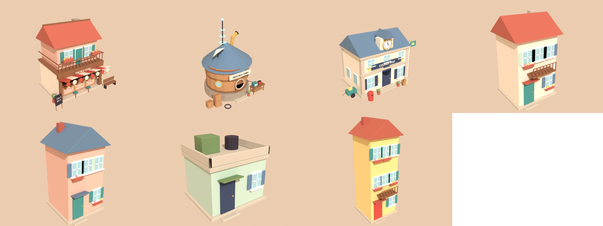
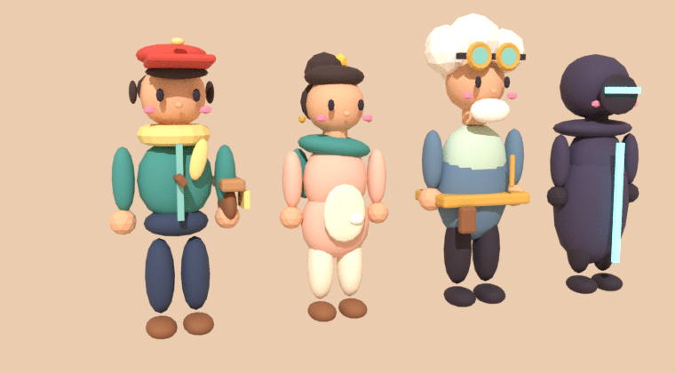

## Code

| File | Role |
|---|---|
| `src/main.js` | scene, quest flow, conversations, save, loop |
| `src/world.js` | builds Blockhaven from `layout.js` (instanced houses, trees, props) |
| `src/planet.js` | map → sphere projection, ground shader (lanes, cobbles), sky |
| `src/player.js` | KAI's movement + the camera rig |
| `src/character.js` | procedural animation for the jointed Blender characters |
| `src/post.js` | ink outlines |
| `src/fx.js` | envelope, particles, smoke, birds |
| `src/ui.js`, `src/style.css` | dialogue, prompts, satchel, title, touch controls |
| `src/audio.js` | synthesized sound |
| `src/pay/` | wallet, QR scanning, checkout and receipts (see [Scan & pay](#scan--pay)) |

## Known limitations

- **INR/UPI payouts are simulated.** No licensed payout partner is integrated.
- Real testnet **swaps** aren't integrated; Swap works on DEMO assets at fixed play rates.
- The gateway stores payments in a JSON file: fine for a demo, not for production.
- A USDT payment takes two signatures (approve, then pay), and writing the Arkiv record switches
  the wallet to the Arkiv chain.
- USDT/INR comes from CoinGecko's public API; a fixed, labelled fallback rate is used when it's
  unreachable.

- One chapter. Echo's thread is set up but not continued.
- Characters use rigid jointed limbs (no skinned meshes or authored animation clips).
- The planet beyond Blockhaven is forest only; the village is the focus.
- Shadows are limited to a ~40 m area around KAI.

## How AI was used

Built with Claude (Anthropic) as a pair programmer for the Blender scripts, game code, payment
gateway, contract, tests and writing, per ETHGlobal's rules. In the product, AI (0G inference) only
adds a second opinion to the QR risk check, and can never lower the rules' verdict. Every asset and screen was rendered and checked during development.
