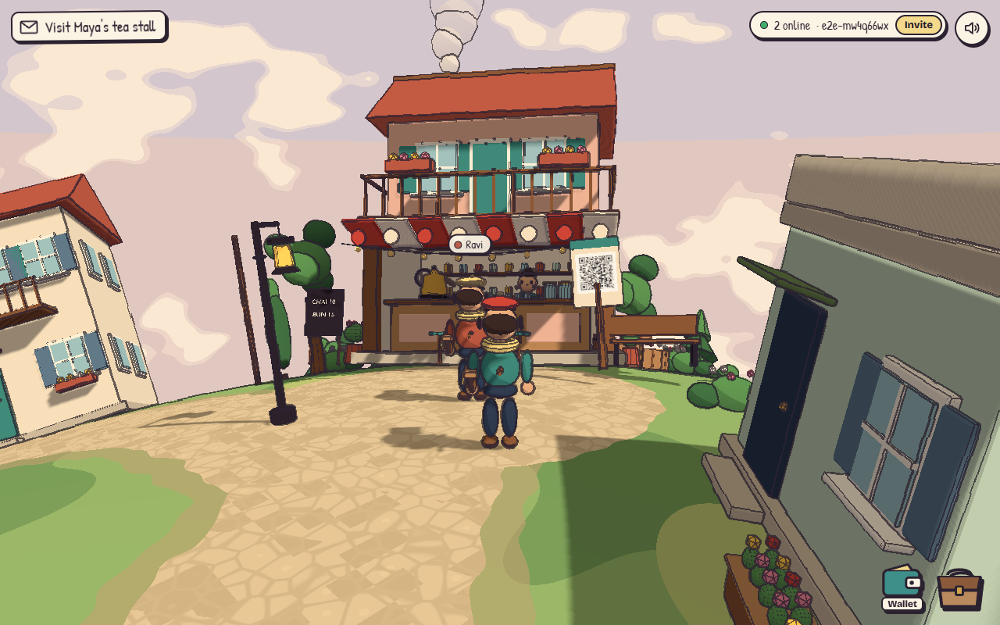
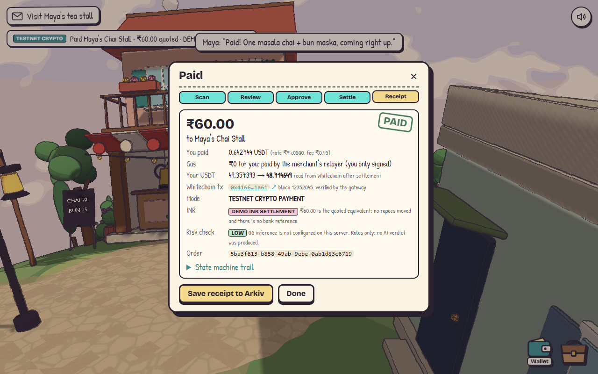
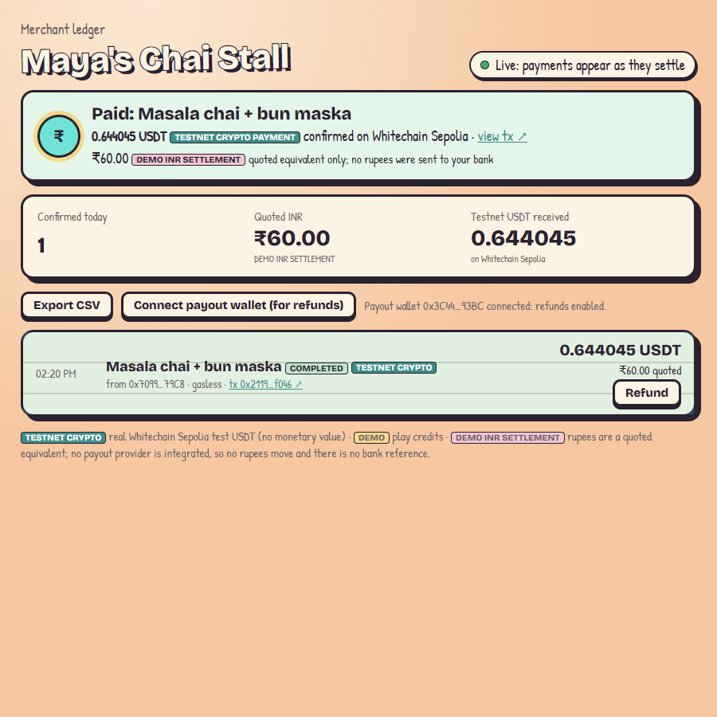
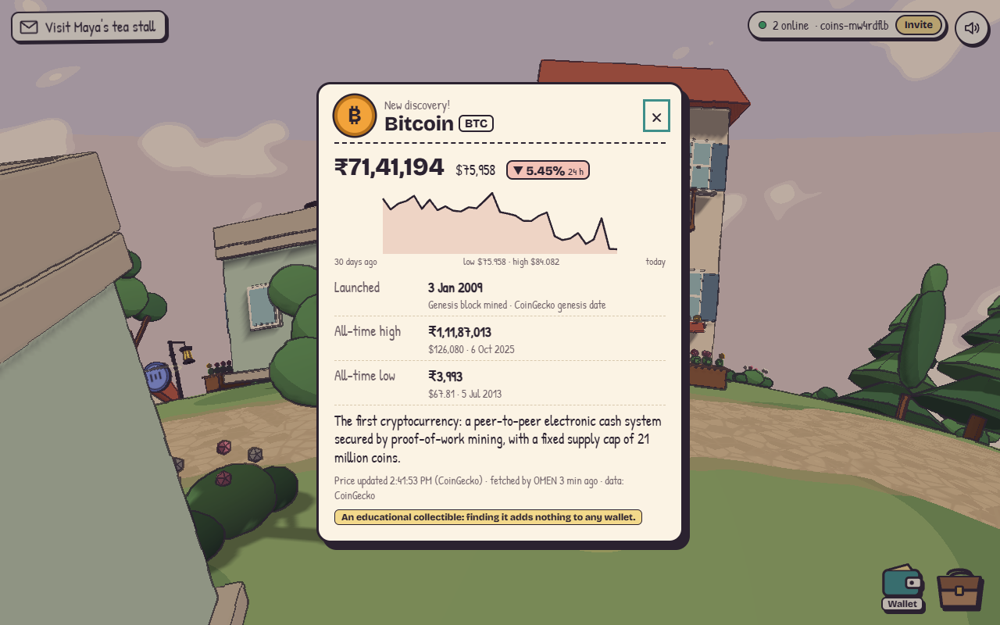

# OMEN: The Last Block

A small multiplayer story game about a courier, a missing payment, and a network that is quietly
failing, with a **real stablecoin checkout** inside it.

You are **KAI**, a courier on a tiny planet. In the village of **Blockhaven**, Maya's tea stall has
a problem: a customer's payment for forty cups of festival chai has been "pending" since dawn.
Follow the receipt to Orin, the eccentric relay engineer, relight the plaza's network lantern, and
deliver his sealed findings back to Maya. Then find out who has been watching you from the lookout.

Bring friends: everyone with the invite link walks the same village. Scan the UPI QR on Maya's sign
and pay in **Whitechain Sepolia test USDT** with one wallet signature and **no gas**, while Maya's
ledger on another device shows the payment the moment it settles. Find crypto coins along the lanes
and read live market data on each.

> **What's real and what isn't.**
> - **TESTNET CRYPTO PAYMENT**: real transactions on Whitechain Sepolia in its official test USDT,
>   which has no monetary value. **DEMO**: 1,000,000 play credits that live in your browser.
> - **DEMO INR SETTLEMENT**: the rupee amount is a *quoted equivalent*. A UPI QR alone can't put
>   rupees into a bank account; that needs a licensed payout partner, and none is integrated. No
>   rupees move, and OMEN never generates a bank receipt, UTR or payout reference.
> - Crypto discoveries are **educational**: finding one adds nothing to any wallet.
> - The *story's* blocks and relays are fiction.



| | |
|---|---|
|  |  |
|  |  |

<sub>Screenshots marked *local fork* were taken against an anvil fork of live Whitechain Sepolia
(chain 1874, real test-USDT contract); their tx links don't exist on the public explorer. See
[Sponsor evidence](#sponsor-evidence) for what has and hasn't run on the public testnet.</sub>

## Play

```bash
npm install
npm run dev                  # game, merchant ledger, API and multiplayer on http://localhost:5173
npm run build && npm start   # production: everything from one Node process on :8787
```

- **Solo:** open the page and press Start. DEMO credits work with no setup.
- **With friends:** press *Play with friends* (or *Invite* in game). The link (`?room=…`) puts
  everyone in the same room. For friends on other devices the server must be reachable by them:
  your LAN (`npm run dev -- --host`) or a deployment ([Deploy](#deploy)).
- **Merchant view:** `/merchant.html?m=maya-chai` on another device, unlocked with that
  merchant's access key (`MERCHANT_KEYS`).

**Controls:** W/S/A/D (or arrows) move relative to the camera, Shift runs, Space jumps, E interacts,
drag to look, Tab opens the satchel, P opens the wallet, Esc closes panels. Phones get a joystick,
Talk/Jump buttons and a swipe-to-look area. Add `?dev=1` for the frame-rate overlay.

### Judge demo (about 3 minutes)

1. A teammate opens the invite link: you see each other's couriers, name tags and outfits.
2. Explore Blockhaven together; the feed shows what the other courier does.
3. Walk to the **Bitcoin** coin and press E: live INR/USD price, 24 h change, 30-day chart, launch
   date, all-time high and low.
4. Walk to Maya's stall and press E on her QR sign.
5. Pick an item, pay with **USDT**: one signature in the wallet, no gas, settled on Whitechain.
6. Maya's ledger (another device) chimes with the confirmed payment and its explorer link.
7. Both inspect the receipt; *Save receipt to Arkiv*, refresh, and History reloads it from Arkiv.

See [docs/demo-video-checklist.md](docs/demo-video-checklist.md).

## Features

**Movement.** Camera-relative W/S/A/D, measured in a browser test against the camera's axes: each
key moves purely along its own axis. KAI travels where you point immediately while the body turns
smoothly. Held keys are released whenever a panel or dialogue opens or closes, and the camera eases
its wall pull-in. Simulation stays real-time down to 10 fps.

**Multiplayer** (Socket.IO). Rooms by invite URL, courier name and six outfits recoloured on the
original Blender model, remote couriers interpolated 120 ms behind real time, name tags, join/leave
notices, reconnection that resumes the same courier. Others see *what* you do ("Ravi paid Maya")
but never wallet balances, amounts or addresses. The server validates and rate-limits every message.

**Crypto discoveries.** Bitcoin, Ethereum, Solana, Tether, USD Coin and WhiteBIT Coin, placed along
the lanes by a generator seeded with the room code, so everyone in a room finds them in the same
places. Each card shows CoinGecko data cached by the backend: price in INR and USD, 24 h change,
30-day chart, launch date with what it means and where it comes from, all-time high and low with
dates, CoinGecko's update time and OMEN's fetch time. If CoinGecko is down, the last good data is
shown marked stale with its age; with nothing cached, the card says prices are unavailable.

**Gasless checkout (Whitechain Operate).** The payer never sends a transaction:

1. Scan Maya's QR (the game decodes the sign's pixels), pick an item, choose USDT.
2. The gateway quotes: what the merchant receives in INR, the 0.75% fee, the live USDT/INR rate and
   its timestamp, recipient, network, and *₹0 network fee for you*.
3. A safety check runs: rules (spoofed names, lookalike UPI IDs, scam wording) plus 0G inference
   when configured; the AI can only raise risk.
4. The payer signs **one EIP-3009 `ReceiveWithAuthorization`** for exactly the quoted USDT, made out
   to the checkout contract. Its nonce is derived from the order (id, merchant, amount, INR,
   deadline), so it can only settle that exact order, and only the checkout can redeem it.
5. The merchant's relayer submits `OmenCheckout.payWithAuthorization` and pays the WBT gas.
6. The gateway reads the receipt from Whitechain and checks the contract, the `Paid` event's
   order, merchant, payer and amount before calling the order paid. A tx can settle one order once.
7. The receipt shows the payer's USDT balance before and after, read back from the chain.

The classic approve-and-pay path still exists in the contract for wallets that can't sign typed data.

**Merchant ledger** (`merchant.html`). Payments arrive live over Socket.IO as the gateway confirms
them, with a chime and the explorer link. History and **CSV export** come from the merchant API.
**Refunds** are sent from the merchant's own payout wallet, enabled only when the connected wallet
is the merchant's on-chain payout address. Merchants' backends can also get **signed webhooks**
(`X-Omen-Signature: t=…,v1=HMAC-SHA256`), delivered once per event and retried on 5xx.

**Checkout SDK** (`/sdk/omen-checkout.js`). A dependency-free module for any web page; the demo
shop at `/sdk/demo.html` integrates it in 13 lines:

```js
import { OmenCheckout } from "https://<gateway>/sdk/omen-checkout.js";
const checkout = new OmenCheckout({ gateway: "https://<gateway>", merchant: "maya-chai" });
const receipt = await checkout.pay({ inr: "60.00", note: "Masala chai" });
console.log(receipt.explorer); // resolves only after the gateway verified the tx on-chain
```

**Arkiv records.** *Save receipt to Arkiv* writes a read-only `omen.record.v1` entity from the
player's own wallet (Rabdi testnet); courier deliveries from the story can be written too. History
queries the wallet's records back from Arkiv every time it opens, so they survive a refresh. A
real-world payee's UPI ID is never written; it's recorded as `external`. See [arkiv/](arkiv/).

**Off-ramp seam.** `server/offramp.js` is where a licensed INR payout partner would plug in. INR
counts as settled only when such a provider confirms it with its own reference; until then every
screen, notification and record says DEMO INR SETTLEMENT.

**Why this flow needs onchain stablecoin settlement:** the merchant gets a payment that is final,
in a stable unit, checkable by anyone from a public receipt, and payable by someone without an
Indian bank account; a USDT transfer on Whitechain gives all four, and the gateway proves it by
reading the chain instead of trusting the payer's app.

## Architecture

```
 browsers                                         one Node process (server/)
 ┌──────────────────────────────┐   /api/*    ┌──────────────────────────────────────────┐
 │ game (three.js)              │ ──────────► │ payments.js  state machine + relay       │
 │  src/pay   wallet · checkout │             │ relayer.js   pays gas for signed orders ─┼─► Whitechain
 │  src/net   multiplayer       │ ◄─ ws ────► │ realtime.js  rooms · merchant channel    │    Sepolia
 │  src/collectibles · coincard │             │ market.js    CoinGecko cache ────────────┼─► CoinGecko
 │ merchant.html  ledger        │ ◄─ ws ───── │ webhooks.js  signed merchant webhooks    │
 │ /sdk/omen-checkout.js        │             │ risk.js + zerog.js  rules + 0G ──────────┼─► 0G
 └──────┬───────────────┬───────┘             │ chain.js     verifies receipts on-chain  │
        │ signs (no gas)│ writes own records  │ offramp.js   INR provider seam (none)    │
        ▼               ▼                     └──────────────────────────────────────────┘
   wallet (EIP-1193)   Arkiv Rabdi
```

| Path | Role |
|---|---|
| `contracts/src/OmenCheckout.sol` | Checkout for official test USDT: gasless `payWithAuthorization`, `pay`, merchant `refund`; pay-once orders, quote deadlines |
| `server/payments.js`, `server/stateMachine.js` | Quote → risk → authorize → relay/submit → verify → INR leg; audit trail |
| `server/relayer.js` | Simulates first, gas cap, hourly cap, low-balance floor |
| `server/realtime.js`, `src/net.js` | Multiplayer rooms; merchant notifications |
| `server/market.js`, `src/collectibles.js`, `src/coincard.js` | Crypto discoveries |
| `shared/eip3009.js` | Typed data + nonce (pinned against Solidity's `abi.encode`) |
| `shared/upi.js`, `shared/money.js`, `shared/arkivRecord.js` | UPI parsing, integer money maths, Arkiv schema |
| `src/merchant.js`, `public/sdk/` | Merchant ledger; checkout SDK + demo shop |
| `src/perf.js` | Adaptive quality and the `?dev=1` overlay |

## Security

- No keys in the browser. The relayer key is server-only and testnet-only; merchant keys and
  webhook secrets live in the server environment. Secrets never reach the browser bundle (checked).
- The browser checks every term of a signature request (domain, payer, checkout, exact amount) and
  the checkout's token on-chain before asking the wallet; the SDK does the same.
- The server never trusts the client: settlement is verified from chain receipts; tx hashes can't be
  reused; relays lock the order before any await, so one order spends relayer gas once; retries are
  idempotent; a late report of an in-time payment has a 10-minute grace window.
- Hardened UPI parsing; QR text goes to the model as data, and the model can only raise risk.
- Multiplayer: validated, rate-limited, room-isolated messages; no payment details shared.
- Merchant API and channel need that merchant's key (constant-time comparison); CSV export is
  formula-injection safe; webhooks are signed and timestamped.
- JSON-only API with body caps, per-IP rate limits (`TRUST_PROXY=1` behind a host's proxy),
  `no-store`/`nosniff`, no CORS by default, path-traversal-safe static serving, escaped output.

## Tests

| Command | What it proves |
|---|---|
| `npm test` | 68 Node tests: UPI attacks, money maths, every state transition, gasless relay with real signatures (wrong signer, tampered terms, concurrency, expiry), off-ramp rules, Socket.IO rooms/isolation/resume/merchant auth, webhooks, CSV, market cache |
| `npm run test:contracts` | 18 Solidity tests (+2 fork tests): gasless checkout, relayer can't change terms, replay, expiry, refunds, access control, fuzzing |
| `npm run test:fork` | Gasless checkout and refund against the **real TetherTokenV2** on a fork of live Whitechain Sepolia |
| `node e2e/movement.mjs <url>` | W/S/A/D along the camera's axes, no stuck keys, Shift runs, Space jumps |
| `node e2e/multiplayer.mjs <url>` | Two independent browsers: see each other, outfits, movement sync, feed, no payment details, reconnect, leave |
| `node e2e/collectibles.mjs <url>` | Same coins per room, live card fields, nothing credited, other player notified |
| `node e2e/gasless-fork.mjs <url>` | In-game gasless payment: one signature, payer WBT 0 → 0, nonce unchanged |
| `node e2e/merchant-fork.mjs <url>` | Customer pays in one browser; Maya's ledger in another is notified, exports CSV, refunds |
| `node e2e/sdk-fork.mjs <url>` | The SDK on a plain web page: gasless payment in 13 lines |
| `node e2e/fps.mjs <url>` | Frame rate while walking (median, 5th percentile, adaptive level) |

Browser tests use `playwright-core`; set `CHROME_PATH` to a Chrome/Chromium binary. The `-fork`
tests need the local fork below.

### Performance

`e2e/fps.mjs`, 20 s walking loop at 1280×800, measured 2026-11-06:

| Renderer | Median fps | 5th percentile | Adaptive quality |
|---|---|---|---|
| NVIDIA RTX 5050 Laptop GPU | 165 | 165 | stays *high* |
| SwiftShader (CPU software rendering, worst case) | 6.2 | 6.0 | drops to *lowest* |

165 fps is the display's refresh cap. A typical integrated-GPU student laptop hasn't been measured
yet; run `E2E_GPU=1 node e2e/fps.mjs` on one. When the average stays under 40 fps, quality steps down
(render scale 1 → 0.85 → 0.7 → 0.55, then the shadow map), and steps back up when there's headroom.

## Configure and deploy

Copy `.env.example` to `.env`. `DATABASE_URL` and applied PostgreSQL migrations are required,
including DEMO mode. The integration keys below are optional.

| Setting | For |
|---|---|
| `CHECKOUT_ADDRESS` | Deployed OmenCheckout on Whitechain Sepolia |
| `RELAYER_PRIVATE_KEY` | Gasless checkout: a fresh testnet-only key with a little WBT (~187k gas per payment) |
| `MERCHANT_KEYS` | `maya-chai:<secret>,orin-relay:<secret>`: unlocks each merchant's ledger and API |
| `WEBHOOKS`, `WEBHOOK_SECRET` | Signed payment webhooks to merchants' backends |
| `VITE_ARKIV_ACCESS_KEY` | Arkiv RPC access key (public by design; restrict it to your origin) |
| `ZG_API_KEY`, `ZG_BASE_URL`, `ZG_MODEL` | 0G inference for the safety check |
| `COINGECKO_API_KEY` | Higher CoinGecko limits (free demo key) |

**Deploy the checkout** (needs WBT from the [faucet](https://faucet.testnet.whitechain.io)):

```bash
cd contracts
forge script script/Deploy.s.sol --rpc-url whitechain_sepolia --private-key $DEPLOYER_KEY \
  --broadcast --verify --verifier blockscout --verifier-url https://explorer.testnet.whitechain.io/api/
```

### Deploy

Follow [the production deployment runbook](docs/PRODUCTION-DEPLOYMENT.md) for exact manual
commands, environment names, migration/legacy import, verification and rollback steps.
The existing Docker/Render setup runs frontend, API and Socket.IO in one instance and one
origin. PostgreSQL persists receipts, accounts, ads and uploaded image bytes; `/data` is
retained for legacy import/backup. Render terminates HTTPS/WSS. Auto-deploys are disabled in
the blueprint, and its pre-deploy command applies additive migrations. No service is
created, deployed or charged merely by editing these files.

### Verify on a local fork

No testnet funds needed. Anvil's dev accounts are unlocked, so no keys are involved.

```bash
anvil --fork-url https://rpc.testnet.whitechain.io/ --chain-id 1874 --port 8545   # terminal 1
bash scripts/fork-setup.sh        # deploys, gives the payer 50 USDT and 0 WBT, prints CHECKOUT_ADDRESS
WHITECHAIN_RPC=http://127.0.0.1:8545 VITE_WHITECHAIN_RPC=http://127.0.0.1:8545 \
  CHECKOUT_ADDRESS=<printed> RELAYER_PRIVATE_KEY=<anvil dev key #3> MERCHANT_KEYS=maya-chai:<secret> \
  npm run dev -- --port 5181
node e2e/gasless-fork.mjs http://localhost:5181/
```

`scripts/fork-setup.sh` refuses any RPC that isn't local, and deletes forge's broadcast files
because the fork reuses chain ID 1874.

## Sponsor evidence

Checked on 2026-11-06 against the [ETHGlobal Mumbai prize page](https://ethglobal.com/events/mumbai/prizes/).
**Only PASS rows are done. Don't claim anything PENDING or BLOCKED.**

| Sponsor | Requirement | Status | Evidence |
|---|---|---|---|
| Whitechain | Contract on Whitechain Sepolia (1874), verified | PENDING: funded deployer key + approval | Deploy simulated against live 1874. Address: _TODO_ |
| Whitechain | ≥ 1 payment in official test USDT in the main flow, explorer link here | PENDING: relayer WBT, payer test USDT, a wallet signature | Proven on a fork of live 1874 only. Tx: _TODO_ |
| Whitechain | Operate: payer signs no gas-costing tx | PASS (on fork) | Gasless EIP-3009 checkout; e2e: payer WBT 0 → 0, nonce unchanged |
| Whitechain | Operate: merchant integration in ~20 lines; merchant + customer views | PASS (on fork) | SDK demo shop (13 lines), merchant ledger |
| Whitechain | Operate extra credit: refund, export | PASS (on fork) | Merchant refund from payout wallet; CSV export |
| Whitechain | Why onchain stablecoin settlement; setup/architecture/limitations | PASS | This README |
| Whitechain | `WHITECHAIN_FEEDBACK.md` | PASS | [WHITECHAIN_FEEDBACK.md](WHITECHAIN_FEEDBACK.md) |
| Whitechain | Public repo with steady progress; 2–4 min video | PENDING: push approval; video | History below |
| Arkiv | Writes to Rabdi with the SDK; a user-visible feature reads it | PENDING: a wallet signature with Rabdi test GLM | Live read from the browser works (0 records today). Write: _TODO_ |
| Arkiv | Writer wallet(s) + one runnable query | PENDING (wallet) / PASS (query) | [arkiv/schema.md](arkiv/schema.md) |
| Arkiv | `/arkiv/` files | PASS | [arkiv/](arkiv/) |
| Arkiv | Open-source license; AI disclosure | PENDING: choose a license / PASS | [How AI was used](#how-ai-was-used) |
| Arkiv | Track eligibility ("from scratch at Mumbai") | PENDING: your confirmation | See history below |
| 0G | Not targeted | — | Wired as an optional safety check; AI isn't the core product, so no 0G track is claimed |

**Arkiv writer wallets:** _TODO after the first live write._

### Before and during the hackathon

ETHGlobal Mumbai ran 2026-11-05 to 2026-11-07. All times UTC, 2026-11-06:

- 02:53 `89195db` *OMEN: The Last Block, chapter one*: the game (world, characters, quests).
- 04:04 Whitechain checkout contract, payment gateway, scan & pay, docs.
- 06:53 Movement fixes. 07:03 Gasless checkout. 08:45 Multiplayer, merchant notifications,
  webhooks, CSV. 08:50 Merchant ledger and refunds. 09:17 Crypto discoveries. 09:19 Adaptive
  quality. 09:22 Checkout SDK. 09:24 Deployment prep. 09:25 Arkiv history after refresh.

All Arkiv work (schema, writes, reads, `/arkiv/` files) was added on 2026-11-06.

## What's in it

- **One handcrafted neighbourhood** wrapped onto a small planet: a cobbled plaza with the relay
  lantern, winding lanes, Maya's two-storey tea stall, Orin's round relay workshop, the courier
  post office, homes with flower boxes and balconies, lanterns, benches, a well, market stalls,
  and a forest over the rest of the planet.
- **Original Blender assets**, generated by reproducible `bpy` scripts in [`tools/blender/`](tools/blender/):
  three hero buildings, four modular houses, sixteen props, and four characters with jointed limbs.
  Exported as Draco-compressed GLB to [`public/models/`](public/models/).
- **Illustrated look:** two-tone toon shading, a Sobel ink-outline pass with a hand-drawn wobble,
  real soft shadows that follow KAI, a banded golden-hour sky with painted clouds, cobblestones
  generated in the ground shader.
- **Life:** procedural walk/run/idle/talk/wave/cheer animation, chimney smoke, circling birds, relay
  sparks, festival petals, lanterns that light up when the payment clears.
- **Story:** the full first chapter, *The Missing Payment*, with dialogue choices, a satchel of
  items, a subtle objective envelope, and a chapter-complete card.
- **Sound:** a synthesized soundscape (wind, birdsong, footsteps, dialogue voices, chimes). No audio
  files are used.

## Assets

```bash
python3.11 -m pip install bpy          # Blender as a Python module (Blender 5.0)
python3.11 tools/blender/build_all.py  # rebuilds every GLB; add --preview for Cycles previews
```

| Script | Makes |
|---|---|
| `buildings.py` | `chai_shop`, `workshop`, `post_office`, `house_a`–`house_d` |
| `props.py` | trees, bush, lantern post, bench, fence, planter, crates, signpost, notice board, relay lantern, well, market stall, rocks, string pole |
| `characters.py` | `kai`, `maya`, `orin`, `echo` (nodes: legL, legR, body → head, armL, armR) |

Conventions: 1 unit = 1 m, base at z = 0, front faces −Y in Blender (+Z in the game), colours from
one shared palette. Objects named `dyn_*` stay separate so the game can animate them.


## Code

| File | Role |
|---|---|
| `src/main.js` | scene, quest flow, conversations, save, loop |
| `src/world.js` | builds Blockhaven from `layout.js` (instanced houses, trees, props) |
| `src/planet.js` | map → sphere projection, ground shader (lanes, cobbles), sky |
| `src/player.js` | movement + the camera rig |
| `src/character.js` | procedural animation; courier outfits |
| `src/post.js` | ink outlines |
| `src/fx.js` | envelope, particles, smoke, birds |
| `src/ui.js`, `src/style.css` | dialogue, prompts, satchel, title, touch controls |
| `src/audio.js` | synthesized sound |
| `src/net.js` | multiplayer |
| `src/pay/` | wallet, QR scanning, checkout and receipts |

## Known limitations

- **No real INR payout.** No authorized payout provider is integrated; rupees are a quoted equivalent.
- Nothing has run on the **public** Whitechain or Arkiv testnets yet (see Sponsor evidence).
- Rooms and merchant sockets live in memory (one server instance); payment history is a JSON file.
- Real testnet **swaps** aren't integrated; Swap works on DEMO assets at fixed play rates.
- Writing an Arkiv record switches the wallet to the Arkiv chain and needs Rabdi test GLM.
- Remote couriers walk through each other (no player-to-player collision).
- One chapter; Echo's thread is set up but not continued. Characters use rigid jointed limbs.
- USDT/INR and market data come from CoinGecko's public API (rate-limited); fallbacks are labelled.

## How AI was used

Built with Claude (Anthropic) as a pair programmer for the Blender scripts, game code, payment
gateway, contract, multiplayer, tests and writing, per ETHGlobal's rules. In the product, AI (0G
inference, when configured) only adds a second opinion to the QR safety check, and can never lower
the rules' verdict. Every asset and screen was rendered and checked during development.
